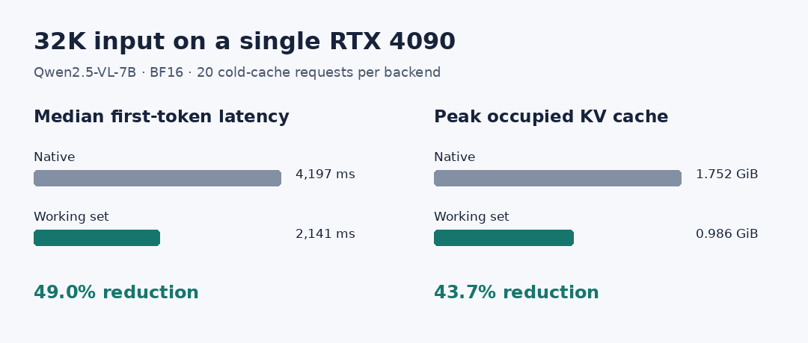

# MLLM Token Compressor

A single-GPU Qwen2.5-VL serving experiment for long-history GUI agents. It selects the history that the next action needs before vLLM encodes screenshots and allocates KV blocks.



On the original 32K text-heavy synthetic input, the working-set path retains 18,432 of 32,768 prompt tokens. Across 20 measured requests per backend on an RTX 4090, TTFT p50 goes from **4,197 ms to 2,141 ms** and peak occupied KV falls **43.71%**. These numbers include the CPU planner and use BF16 with the same cache-pool configuration.

## How it works

1. Keep the latest screenshot, current instruction, system instructions, and the most recent tool interaction.
2. Resolve explicitly referenced records and their dependencies. Fill remaining capacity by BM25 with a recency tie-break.
3. Render the selected records in source order. Register the compact prompt through native Qwen/vLLM processing, which computes its M-RoPE positions and allocates KV blocks for its actual length.
4. Fall back to the original input if protected records exceed the budget, a reference is missing, or native preprocessing would exceed the selected token budget.

The working-set policy borrows from [operating-system locality](https://doi.org/10.1145/800001.811670) and lexical retrieval. The first visual-only implementation and its measured regressions are documented in the [Step 4 report](evaluation_report.md).

## Experiments

- [Working-set evaluation](docs/gui-evaluation.md) covers the original 32K cold-cache workload, mixed concurrency, and paired ScreenSpot pointing.
- [Annotated replay](docs/gui-replay.md) shows a retained historical dependency and the model's click on a real screenshot. The historical events and tool records are synthetic and labeled for evaluation.
- The replay compares native inference, visual-only pruning, recency, BM25, the working set, and an oracle that keeps the labeled evidence.

With the frozen pixel coordinate protocol, both paths score 83.81% on all 1,272 standalone ScreenSpot samples. Those inputs have no removable history.

In the 72 held-out replays, the working set retains all labeled evidence and scores **30/72** clicks, compared with **27/72** for native inference and **6/72** for recency alone. BM25 also scores **30/72**. Replay TTFT p50 is **816 ms → 359 ms** against native inference. The replay uses real screenshots and labeled synthetic histories, with different lengths from the synthetic 32K performance test.

## Reproduce on AutoDL

Use the project's existing Python environment, local Qwen2.5-VL-7B-Instruct weights, and original [ScreenSpot release](https://github.com/njucckevin/SeeClick#gui-grounding-benchmark-screenspot) extracted into `data/screenspot`.

```bash
bash scripts/reproduce_gui.sh
```

Run the focused tests or opt into the real-model suite.

```bash
.venv/bin/python -m pytest tests/test_working_set.py tests/test_gui_protocol.py tests/test_gui_replay.py -q
MLLM_RUN_INTEGRATION=1 .venv/bin/python -m pytest tests/ -q
```
