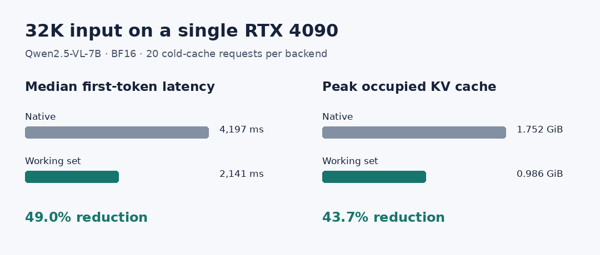

# GUI Agent working-set evaluation

| Goal | Measured | Result |
| --- | ---: | --- |
| 32K TTFT p50 reduction ≥35% | 49.00% | Met |
| 32K occupied KV reduction ≥40% | 43.71% | Met |
| ScreenSpot accuracy change ≥−1 pp | +0.00 pp | Met |

## Cold-cache performance

NVIDIA GeForce RTX 4090, Qwen2.5-VL-7B, BF16, vLLM 0.7.3 V0. Each backend ran in a fresh process with 3 warm-ups and 20 measured rounds per workload. TTFT includes CPU selection, preprocessing, and the first returned token.

### single_32k

| Metric | Native | Working set |
| --- | ---: | ---: |
| TTFT p50 (ms) | 4197.200 | 2140.562 |
| TTFT p95 (ms) | 4234.685 | 2171.738 |
| Output tokens/s | 6.595 | 11.556 |
| Peak GPU device (GiB) | 23.285 | 21.117 |
| Peak GPU process (GiB) | 22.807 | 20.639 |
| Peak PyTorch reserved (GiB) | 22.350 | 20.182 |
| Peak PyTorch allocated (GiB) | 21.736 | 19.835 |
| KV pool (GiB) | 1.806 | 1.806 |
| Peak occupied KV (GiB) | 1.752 | 0.986 |

Retained input tokens by request [18432]. Planner p50 90.15 ms. Fallbacks 0/20.

### mixed_2k_8k

| Metric | Native | Working set |
| --- | ---: | ---: |
| TTFT p50 (ms) | 1008.785 | 1032.873 |
| TTFT p95 (ms) | 1012.540 | 1048.104 |
| Output tokens/s | 39.288 | 38.719 |
| Peak GPU device (GiB) | 23.285 | 21.117 |
| Peak GPU process (GiB) | 22.807 | 20.639 |
| Peak PyTorch reserved (GiB) | 22.350 | 20.182 |
| Peak PyTorch allocated (GiB) | 18.749 | 18.749 |
| KV pool (GiB) | 1.806 | 1.806 |
| Peak occupied KV (GiB) | 0.550 | 0.550 |

Retained input tokens by request [2048, 8192]. Planner p50 13.67 ms. Fallbacks 0/40.

## ScreenSpot

Frozen protocol `qwen-prefilled-point-v3`. The shared Qwen assistant prefix specifies the output field. For pixel-based protocols, coordinates are mapped from the model's resized screenshot into the original image. A predicted point inside the labeled box, including its boundary, is correct. Malformed or out-of-range points count as errors.

| Group | Samples | Native | Working set | Delta (pp) |
| --- | ---: | ---: | ---: | ---: |
| desktop / icon | 140 | 62.86% | 62.86% | +0.00 |
| desktop / text | 194 | 91.24% | 91.24% | +0.00 |
| mobile / icon | 229 | 81.22% | 81.22% | +0.00 |
| mobile / text | 273 | 96.70% | 96.70% | +0.00 |
| web / text | 230 | 86.09% | 86.09% | +0.00 |
| web / icon | 206 | 74.27% | 74.27% | +0.00 |
| Overall | 1272 | 83.81% | 83.81% | +0.00 |

Paired 95% bootstrap interval for the difference [+0.00, +0.00] pp. Invalid answers 2/1272 and 2/1272. Standalone ScreenSpot inputs carry no history. The replay below measures the effect of removing history.

## GUI history replay

ScreenSpot screenshots with deterministic synthetic histories. The current instruction references a ticket, and its linked older tool result names the required target. The selector receives record links. Box annotations are used only for offline scoring. All selection strategies use the same replay budget.

| Path | Click accuracy | Evidence recall | Input p50 | TTFT p50 (ms) | Old screen dropped |
| --- | ---: | ---: | ---: | ---: | ---: |
| native | 27/72 | 72/72 | 5176 | 815.6 | 0/72 |
| visual | 10/72 | 72/72 | 4531 | 1447.4 | 0/72 |
| recent | 6/72 | 0/72 | 2046 | 362.2 | 72/72 |
| bm25 | 30/72 | 72/72 | 2029 | 361.3 | 72/72 |
| working_set | 30/72 | 72/72 | 2029 | 359.2 | 72/72 |
| oracle | 44/72 | 72/72 | 1346 | 298.0 | 72/72 |

[Annotated replay](gui-replay.md)

## Reproduction

Run `bash scripts/reproduce_gui.sh` on AutoDL with the local model and ScreenSpot release already present. ScreenSpot comes from [SeeClick](https://github.com/njucckevin/SeeClick#gui-grounding-benchmark-screenspot), and the tool format adapts Qwen's [computer-use cookbook](https://github.com/QwenLM/Qwen2.5-VL/blob/main/cookbooks/computer_use.ipynb). The original Step 4 visual-only evaluation is archived in `evaluation_report.md`. Raw results from this run are in `outputs/gui/`.
