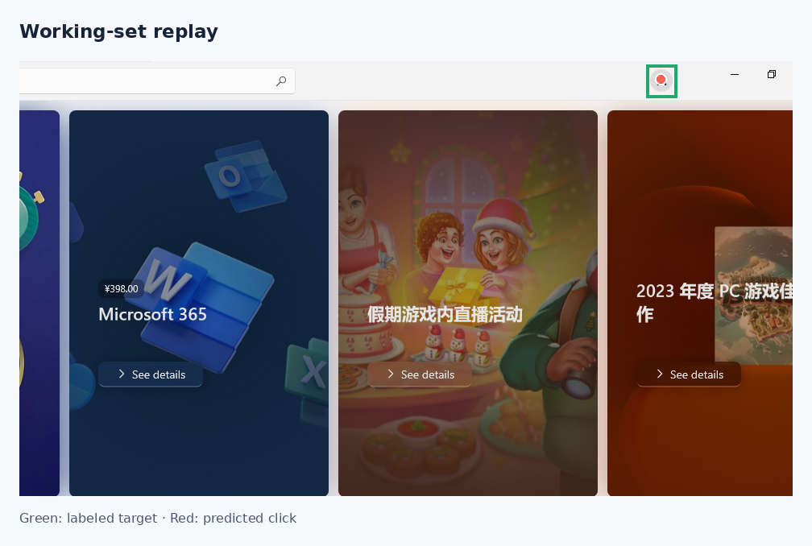

# GUI Agent replay

- ScreenSpot sample `desktop/13`.
- Current request “Resume ticket T-a7070a55. Read its approved tool result to identify the element, then click its center in the current screenshot.”
- The older approved record says “access the personal account interface”.
- Required records `T-a7070a55, result-T-a7070a55`.
- Retained records `log-2, log-6, log-8, result-T-a7070a55, log-12, log-14, T-a7070a55, log-18, log-20, log-24, log-26, log-30, log-32, log-36, log-38, log-42, log-44, log-48, log-50, log-54, log-56, log-60, log-62, log-66, log-68, log-72, log-74, log-78, log-80, log-84, log-86, log-90, log-91`.
- Input tokens 4656 → 2026. Screenshots 2 → 1.
- Predicted click `[829.8319327731092, 41.35338345864662]`. Scored correct.
- Recency-only keeps the required evidence: False.

